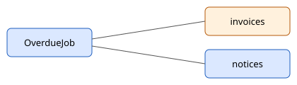

# Design: S-151 Flag overdue invoices every morning
Story: docs/stories/F-FIX/S-151.md   Date: 2026-11-03   Revision: 1

## 1. Challenge round
**Strawman:** a scheduled method in InvoiceService that queries unpaid invoices and sets a flag.
**Where the strawman fails:** AC3 - a rerun sends a second notice; the strawman has no record of notices sent.
**Chosen design:** OverdueJob writes one row per invoice to a new notices collection, keyed by invoice id, so a rerun is a no-op.
**Domain fit:** OverdueJob and Notice use the domain's words.
**Rules touched:** An invoice belongs to exactly one customer - the notice goes to that customer only.

## 2. Approach
A Spring Batch job with one step; the writer upserts by invoice id.

## 3. Flow diagram with impacts

## 4a. Pattern ledger
| Class | Principle / pattern | Force in THIS story (AC or rule id) | Simpler alternative rejected, and why | Verification |
| --- | --- | --- | --- | --- |
| OverdueJob | idempotent writer | AC3 | plain insert - a rerun duplicates notices | OverdueJobTest#rerunSendsOneNotice |

## 8. Repos and files
- ../invoice-service - the job and the notices collection
- ../invoice-service/src/main/java/com/example/invoice/batch/OverdueJob.java - new

## 12. Confidence
Score: 82%
Why:
- one new pattern: an idempotent batch writer
- notices is a new collection
Reviewer should check:
- section 4a, the upsert key

## Lens summary
- rubric: clear
- security: clear
- data-integrity: findings
- domain-fidelity: clear

<!-- baton:provenance
agent: architect
skills: design-diagram, standards, design-review-lenses
profile: domain.md#rules-touched(R1), project.md#repos, stack-detected.md
context: docs/wiki/invoice-service/billing.md@5d6e7f8
graph: impact.json (1 repo, 0 unknown edges)
model: strong (opus)
commit: 5d6e7f8
started: 2026-11-03T10:00:00Z  finished: 2026-11-03T10:40:00Z
tokens: 41200
-->
